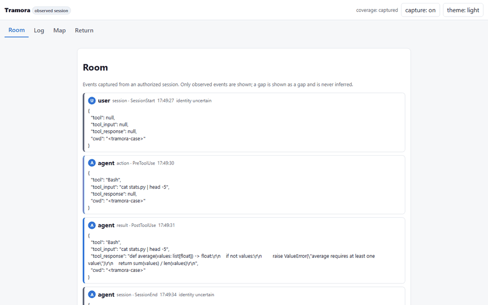
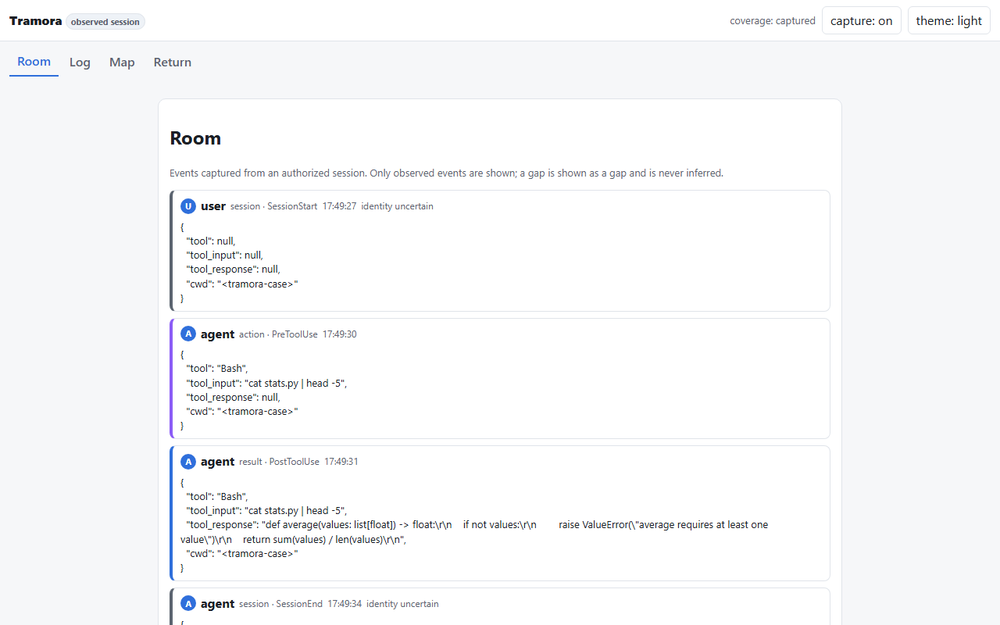

# Tramora

> Follow what your agents build. Understand their decisions. Keep what you learn.

Tramora is an open source visual workspace for people who build software with AI agents. It turns the observable work of the agents into a room, a log and a personal map, so a question, a decision or a change can be recovered days later without rereading several conversations.

It is **local-only, read-only and observed-only**: it never invents a message, never reconstructs an unobserved exchange, and never sends your session to a remote model. Tramora is **not a commercial product and will not be sold**; it is published under the **Apache-2.0** license ([D-008](docs/08-decisions-and-questions.md#d-008--open-publication-under-apache-20-no-commercial-track-2026-10-11)).

<p align="center">
  <a href="docs/img/tramora-walkthrough.gif"></a>
  <br>
  <sub>The four surfaces — Room, Log, Map and Return — over a real Codex session captured through lifecycle hooks. Every card is an event that actually happened; the session id, timestamps, tool names and results are the observed ones. Click to open full size.</sub>
</p>

## What it does

The walkthrough runs end to end, locally:

> observed agent activity → room and log → contextual question → explanation with sources → node saved and marked for review → recovery after reopening.

1. **Room.** Stable visual identities, each agent's assignment, observed status and messages between agents. Every communication link must have a source message or event; an interpretation is shown as an interpretation.
2. **Log.** Each entry maps to one observed event with its provenance. A gap is declared as a gap.
3. **Map.** Keeps questions, explanations, examples, sources, links to decisions and review marks. Nothing is rewritten silently: saving keeps the previous version, and a changed `project_revision` proposes a review while keeping the old version.
4. **Return.** Consultation-only: recent activity, pending results and review marks, with evidence for every signal. Opening it starts no capture and changes no version.

<p align="center">
  <a href="docs/img/session-room.png"></a>
  <br>
  <sub>A real captured session on a local controlled case: <code>SessionStart</code>, a <code>PreToolUse</code> with the command the agent ran, and the <code>PostToolUse</code> result. Every field shown is the observed one.</sub>
</p>

Two capabilities of the proposed experience are **not implemented yet**:

5. **Informed decision.** Explaining what the agent is asking, why, what changes with each option and what remains open — and later sending the human answer back to the worker — is designed ([docs/02](docs/02-experience.md)) but not built.
6. **Resuming with change detection.** The return view shows recent activity, pending results and review marks, and keeps previous node versions, but it does not yet tell whether a saved explanation still applies to the project after changes.

## Status (2026-10-18)

**The light walkthrough runs end to end on real Codex activity, from capture to recovery.** Real Codex sessions were captured through lifecycle hooks, ingested into a local SQLite store and rendered without a remote model — including a separate project, not only the controlled test case. 63 automated tests pass (unit + Playwright accessibility and UI at 320 px, keyboard and `prefers-reduced-motion`).

| Surface | State | Evidence |
|---|---|---|
| Capture through lifecycle hooks | **works** | `SessionStart`, `PreToolUse`, `PostToolUse`, `SessionEnd` captured from a real Codex CLI session |
| Room / Log / Map / Return | **works** | rendered over captured events, not over fixtures |
| Local persistence | **works** | node, explanation and mark survive a reopen ([docs/06](docs/06-validation-protocol.md)) |
| Value pilot (return after 3–7 days) | **run once, n=1** | recovered a node and mark after 3 days; no benefit asserted ([D-010](docs/08-decisions-and-questions.md#d-010--value-pilot-conclusions-registered-2026-10-16)) |
| Panel next to the work in Codex desktop | **not accredited** | the UI is a local web surface; there is no in-host widget |
| Hook coverage gaps | **declared** | a run without capture stays a gap and is never inferred |

The honest limit: **useful presence inside the host is not proven.** The capture source works; the panel adjacent to the work does not exist as an integrated surface. Tramora is used today as a local web view over an authorized session ([D-001](docs/10-plugin-direction-and-technical-test.md), [D-007](docs/08-decisions-and-questions.md#d-007--light-scope-host-and-event-source-2026-10-11)).

## Running it

Requires **Node.js 22.5+** (uses the built-in `node:sqlite`; tested on Node 24).

```bash
cd app
npm install
npm test          # 63 tests: unit (contracts, store, adapter, operations) + Playwright a11y/UI
npm run lint      # node --check on every source file
npm start         # serves the web surface on http://127.0.0.1:4210
```

If Playwright's chromium is missing: `npx playwright install chromium`.

`npm start` serves a **declared fictitious fixture**: it is a demo of the interface, and the UI says so on screen. The server listens on `127.0.0.1:4210` (`TRAMORA_PORT` overrides) and writes `tramora.db` in the working directory (`TRAMORA_DB` overrides); the file is git-ignored.

## Using it on a real project

Capturing a real session needs two pieces: a lifecycle hook in the project and the local connector.

**1. Install the hook in the project**: copy [`app/hooks/tramora-hook.js`](app/hooks/tramora-hook.js) into `<project>/.codex/hooks/` and point `.codex/hooks.json` at it. The hook reads the Codex event from stdin, redacts before writing, and does nothing unless `TRAMORA_HOOK_LOG` is set, so the project stays inert by default.

**2. Capture a session.** With the variable set, Codex runs its hooks and appends one sanitized JSONL line per event:

```bash
export TRAMORA_HOOK_LOG="/path/to/session/hooks.jsonl"
codex exec --dangerously-bypass-hook-trust "your task"
```

**3. Serve the result.**

```bash
TRAMORA_HOOKS_LOG="/path/to/session/hooks.jsonl" \
TRAMORA_DB="/path/to/session/tramora.db" \
TRAMORA_PROJECT="my-project" \
npm run connect
# open http://127.0.0.1:4212
```

The connector (`app/src/connector.js`, `npm run connect`) binds to `127.0.0.1`, serves the same UI against the captured session, and relabels the page as an **observed session** — labelling real activity as a fixture would break the same truthfulness rule as the reverse.

**Note on hook trust.** Codex runs project hooks only for projects it trusts. On a project that is not registered yet, hooks are skipped silently; adding the project to `~/.codex/config.toml` with `trust_level = "trusted"` fixed it here, and `--dangerously-bypass-hook-trust` only bypasses the per-invocation trust prompt. This was observed on Codex CLI 0.160.0, not verified on other versions.

## How it stays truthful

- **Nothing invented.** Every animation, handoff or message attributed to an agent corresponds to an observed event with provenance. If the datum is missing, the gap is shown and the UI stays quiet.
- **Observed ≠ generated.** Observed messages and generated explanations are separate classes, also when exporting. An explanation is never presented as the agent's internal thinking.
- **States are not conflated.** proposal ≠ human decision ≠ acknowledgment ≠ observed result; «not captured» ≠ «does not exist»; «not verified» ≠ «failed»; opening an explanation ≠ understanding it.
- **Minimal and authorized capture.** Only documented, authorized sources; least privilege; read-only. No remote sending by default; generation is local rules.
- **Redaction before persist.** The capture hook redacts secrets and user-profile paths at the source before the JSONL is written; the store re-redacts by sensitive keys. Export keeps observed/generated separate and contains no excluded fields.
- **The map is not silently rewritten.** Saving a node keeps `previous_version`; changing a node's `project_revision` proposes a review and keeps the previous version.

## What is in this repository

- [`app/`](app/README.md) — the runnable light walkthrough: contracts, operations, capture adapter, local explanation service, web UI, tests.
- [`docs/01`](docs/01-context-and-opportunity.md) — origin, initial user and value proposition.
- [`docs/02`](docs/02-experience.md) — screens, interactions, questions, map and decisions.
- [`docs/03`](docs/03-data-and-truthfulness.md) — event model, provenance and rules for never inventing communications.
- [`docs/04`](docs/04-architecture-and-integrations.md) — plugin, reusable web interface, event capture and evolution.
- [`docs/05`](docs/05-mvp-and-roadmap.md) — phases and observable criteria.
- [`docs/06`](docs/06-validation-protocol.md) — controlled technical validation, the value pilot and its measured outcome.
- [`docs/07`](docs/07-research-and-positioning.md) — Facility, related solutions and sources.
- [`docs/08`](docs/08-decisions-and-questions.md) — explicit agreements (D-001, D-005, D-007, D-008, D-010) and open questions.
- [`docs/09`](docs/09-searches-and-visual-inspiration.md) — searches and criteria for saving references.
- [`docs/10`](docs/10-plugin-direction-and-technical-test.md) — decision D-001 (plugin first) and the technical test criteria.

Private working material (the backlog, agent instructions, design plans and the pilot data) is deliberately not in this repository.

## Limits and roadmap

- **In-host panel** next to the work in the ChatGPT desktop app: not accredited. The capture source is hooks; the UI is a local web surface.
- **Recovery friction:** the pilot needed 13 minutes and one extra interaction to open a node's evidence, and the generated explanation repeats event facts. Both are recorded as backlog ([D-010](docs/08-decisions-and-questions.md#d-010--value-pilot-conclusions-registered-2026-10-16)).
- **Hook coverage:** a run whose hooks do not execute stays an uncaptured gap. The `tool_response` field can carry arbitrary tool output, so redaction is a policy at the hook, not a guarantee about content an arbitrary command may print.
- **Value:** measured once with a single participant. No productivity, comprehension or time-saving benefit is asserted.

## License

[Apache-2.0](LICENSE). Copyright 2026 d4rpell; see [NOTICE](NOTICE).
